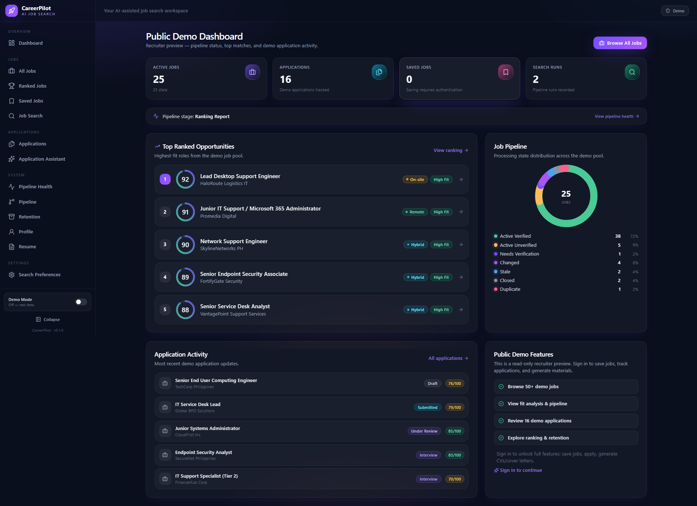
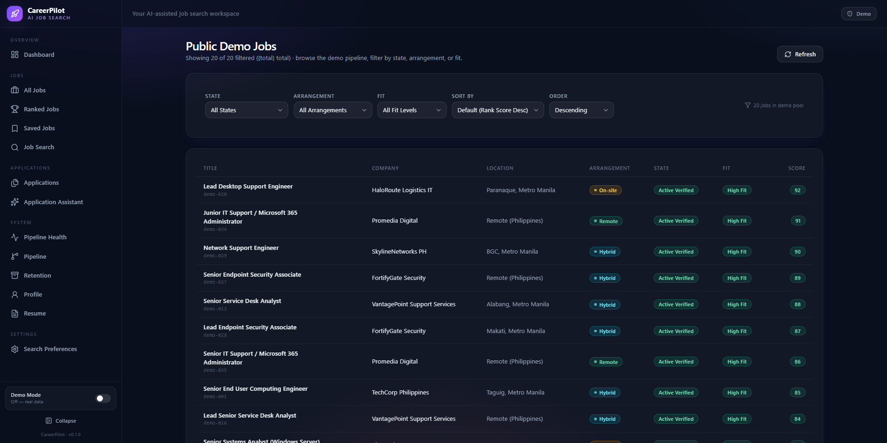
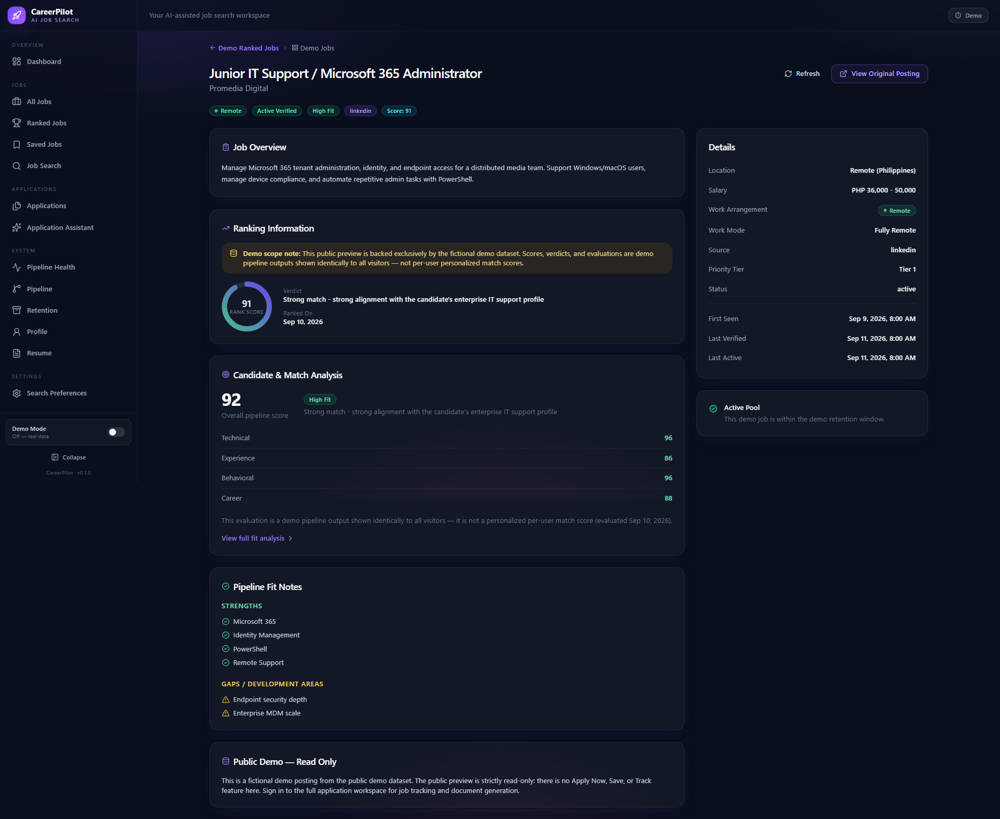
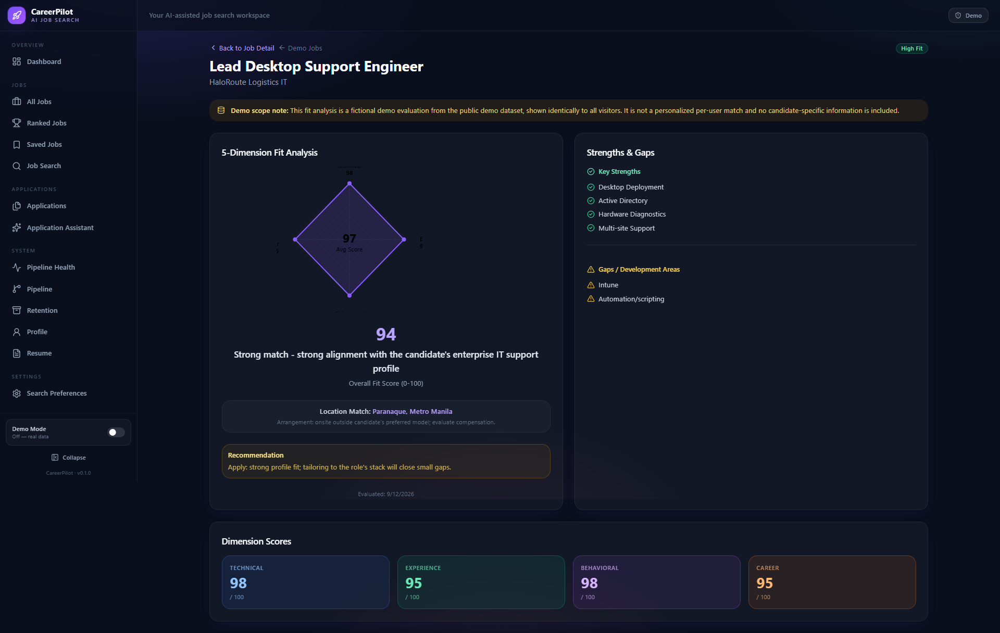
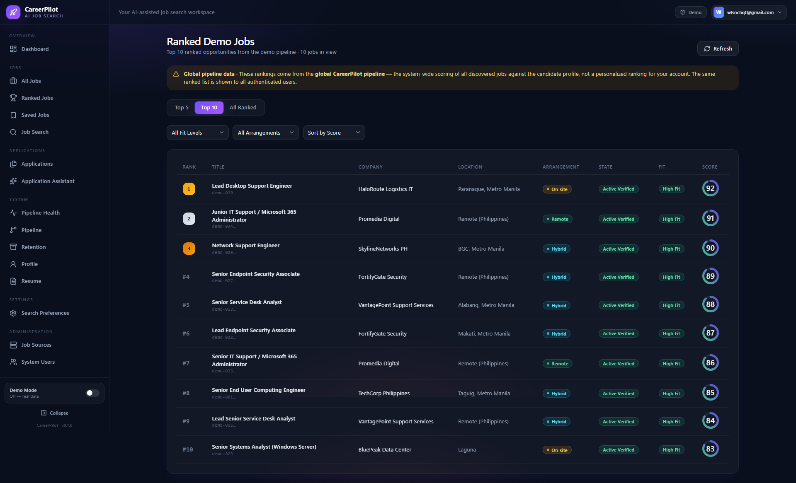
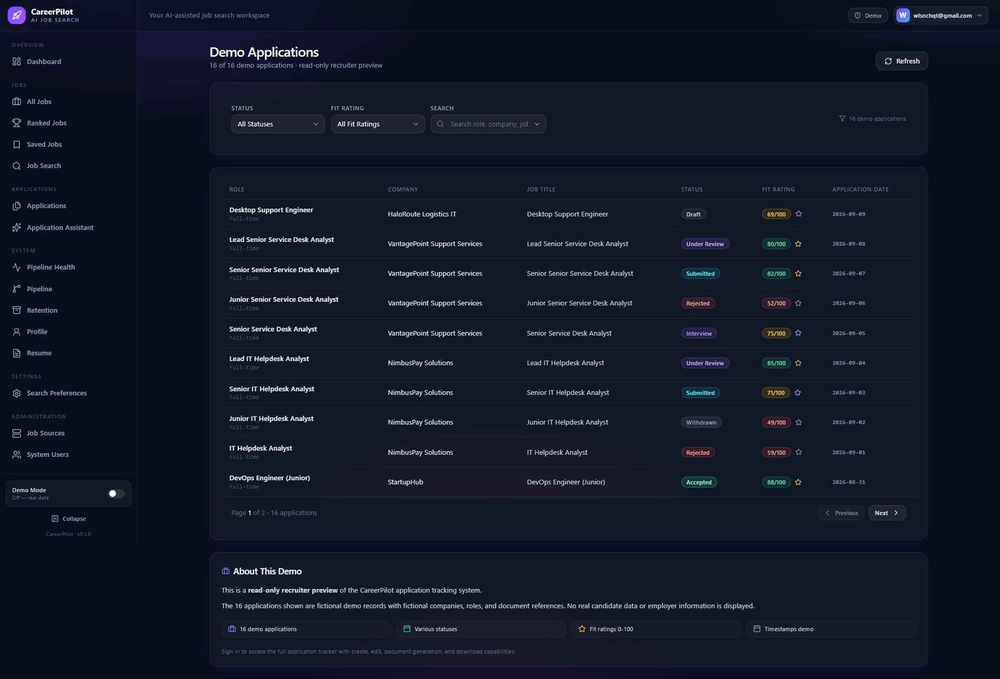
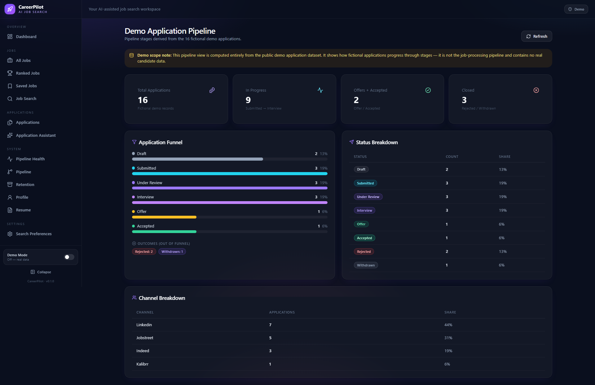
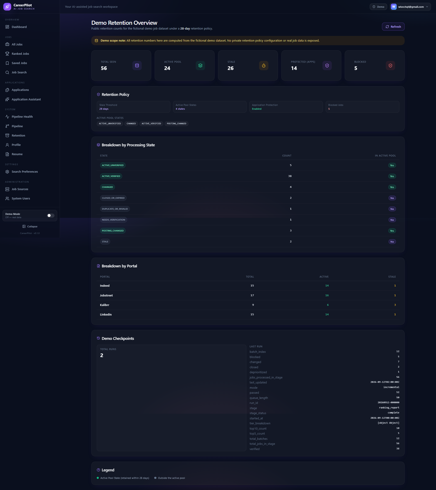

<p align="center">
  
</p>

# CareerPilot

An AI-powered IT job search and application platform focused on job discovery, ranking, fit analysis, application tracking, document generation, and a recruiter-facing public demo.

---

## Overview

CareerPilot is a full-stack platform that helps IT professionals (especially End User Computing, IT Support, and Systems Administration candidates) find, evaluate, and apply to jobs efficiently. It combines:

- **Automated job scraping** from multiple portals with deduplication and incremental processing
- **Fit evaluation** against a detailed candidate profile (skills, experience, behavioral traits, career goals)
- **Application tracking** with a Kanban-style pipeline
- **AI-assisted document generation** — tailored CVs and cover letters (LaTeX, compiled to PDF with verification)
- **Interview preparation** — STAR-based talking points and company research
- **Public recruiter demo** — a read-only, fictionalized showcase of the pipeline for portfolio/recruiter review

The platform is built on **Claude Code** as the AI layer, with a FastAPI backend, React/Vite frontend, and a deterministic job-scraper orchestration engine.

---

## CareerPilot Capabilities

| Area | Description |
|------|-------------|
| **Job Discovery** | Multi-portal scraping (LinkedIn, Indeed, Kalibrr, BossJob, FreeHire, JobStreet, JobBank, JobDanmark, JobIndex, JobNet) with 14-day incremental search |
| **Fit Evaluation** | 5-dimension scoring: technical, experience, behavioral, location, career alignment — with deal-breaker gating |
| **Application Tracking** | CSV-backed tracker with status workflow: draft → submitted → under_review → interview → offer/accepted/rejected |
| **Document Generation** | Drafter-reviewer workflow: tailored CV (moderncv, 1 page) + cover letter (custom `cover.cls`, 1 page), PDF-compiled and ATS-verified |
| **Interview Prep** | Stage-specific prep packs, company research, STAR mapping, mock interviews |
| **Pipeline Analytics** | Retention stats, portal health monitoring, ranked job shortlists (Top 5 / Top 10) |
| **Public Demo** | Recruiter-facing `/demo/*` routes with fictional data — no auth required |

---

## Public Demo

The public demo is a **read-only, fictionalized showcase** deployed at `/demo/*` routes:

| Route | Description |
|-------|-------------|
| `/demo/dashboard` | Top 5 jobs + pipeline health + applications summary |
| `/demo/jobs` | Paginated list of 50 fictional demo jobs with arrangement/fit filters |
| `/demo/jobs/:stableId` | Job detail with evaluation radar chart |
| `/demo/jobs/:stableId/fit` | Detailed fit analysis breakdown |
| `/demo/ranked` | Top 5 / Top 10 / All Ranked tabs (sorted by rank_score) |
| `/demo/applications` | 16 fictional demo applications with statuses and fit ratings |
| `/demo/pipeline` | Pipeline stage distribution |
| `/demo/retention` | Job retention policy and stale/closed stats |

**Data source:** `backend/demo_data/` — entirely fictional companies, roles, and applications (e.g., "TechCorp Philippines", "CloudFirst Inc", "SecureNet Philippines"). No real candidate data, no real job postings, no private information.

**API:** All public demo pages consume `/api/public/*` endpoints backed by `DemoDataStore`. These endpoints require **no authentication**.

### Screenshot Showcase

The following screenshots illustrate the public recruiter-facing demo views (`/demo/*` routes) powered by the fictional demo dataset:

#### 1. Dashboard (`/demo/dashboard`)


#### 2. Jobs (`/demo/jobs`)


#### 3. Job Detail (`/demo/jobs/:stableId`)


#### 4. Fit Analysis (`/demo/jobs/:stableId/fit`)


#### 5. Ranked Jobs (`/demo/ranked`)


#### 6. Applications (`/demo/applications`)


#### 7. Pipeline (`/demo/pipeline`)


#### 8. Retention (`/demo/retention`)


---

## Architecture

```
┌──────────────────────────────────────────────────────────────────────────────┐
│                         SAME-ORIGIN DEPLOYMENT                               │
├──────────────────────────────────────────────────────────────────────────────┤
│                                                                              │
│                    https://careerpilot.example.com                           │
│                                  │                                           │
│                                  ▼                                           │
│                         ┌──────────────────┐                                 │
│                         │      nginx       │                                 │
│                         │   TLS + static   │                                 │
│                         └────────┬─────────┘                                 │
│                                  │                                           │
│                    ┌─────────────┴─────────────┐                             │
│                    │                           │                             │
│                    ▼                           ▼                             │
│        ┌──────────────────────┐    ┌─────────────────────────────────────┐   │
│        │    frontend/dist/    │    │     FastAPI · 127.0.0.1:8000        │   │
│        │                      │    │       single worker                 │   │
│        │ React 19 + Vite 8    │    └──────────────────┬──────────────────┘   │
│        │ BrowserRouter · SPA  │                       │                      │
│        │                      │                       ▼                      │
│        │ try_files $uri       │             ┌───────────────────────────┐    │
│        │ $uri/ /index.html    │             │          Routers          │    │
│        └──────────────────────┘             ├───────────────────────────┤    │
│                                             │ /api/public/* → DemoData  │────┼──▶ Fictional demo
│                                             │ /api/auth/*   → Auth      │────┼──▶ Public auth
│                                             │ /api/*        → Private   │────┼──▶ JWT required
│                                             └───────────────────────────┘    │
│                                                                              │
│   nginx rule: /api/* is matched FIRST and is NEVER rewritten to index.html   │
│                                                                              │
└──────────────────────────────────────────────────────────────────────────────┘
```

**Key architectural decisions:**
- **Single-worker uvicorn** — in-process rate limiter requires exactly one process (`--workers 1`)
- **Loopback-only API** — port 8000 never exposed publicly; nginx is the only public entry
- **Same-origin frontend** — `baseURL: ''` in API client, relative `/api/*` calls
- **SPA fallback** — `try_files $uri $uri/ /index.html` for all `/demo/*` deep links
- **Production gate** — `ENVIRONMENT=production` enforces: `SECRET_KEY` ≥32 chars, explicit `CORS_ALLOWED_ORIGINS`, absolute `DATABASE_URL`, `RATE_LIMIT_ENABLED=true`, `/docs` `/redoc` `/openapi.json` → 404

---

## Security / Public vs Private Boundary

| Plane | Routes | Auth | Data Source |
|-------|--------|------|-------------|
| **Public Demo** | `/api/public/*` | None | `DemoDataStore` (fictional) |
| **Public Auth** | `/api/auth/register`, `/api/auth/login` | None | Real user DB |
| **Private** | All other `/api/*` | JWT | Real DB, scraper data |
| **Admin** | `/api/admin/*` | JWT + admin claim | Real DB |

**Boundary invariants:**
- Public pages (`/demo/*`) call **only** `/api/public/*` — verified by code review
- Private endpoints return `401` for anonymous requests
- Admin endpoints additionally require `admin` claim
- `/docs`, `/redoc`, `/openapi.json` return `404` in production
- Rate limiting: `public.read` scope (120 req/min/IP) at app layer + nginx `limit_req` as defense-in-depth
- `RATE_LIMIT_TRUST_PROXY=true` only valid behind nginx with `X-Forwarded-For`

---

## Technology Stack

| Layer | Stack |
|-------|-------|
| **Backend** | FastAPI, Python 3.11+, SQLAlchemy (async), SQLite (dev) / PostgreSQL (prod), Pydantic, JWT (PyJWT), `slowapi`-style in-process rate limiter |
| **Frontend** | React 19, Vite 8, TypeScript, TanStack Query v5, Tailwind CSS, React Router (BrowserRouter) |
| **Job Scraper** | Node.js/TypeScript CLI skills (`.agents/skills/*`), deterministic orchestration with checkpointing, SHA-256 stable IDs + content fingerprinting |
| **Documents** | LaTeX (moderncv banking style for CV, custom `cover.cls` for cover letter), `lualatex` + `xelatex` compilation |
| **Deployment Packaging** | nginx reverse proxy config, Windows `start_api.cmd` launcher, systemd unit template, production `.env` template |

---

## Demo Dataset

The public demo uses a deterministic fictional dataset (`backend/demo_data/`):

| File | Records | Description |
|------|---------|-------------|
| `demo_seen_jobs.json` | 50 jobs | Fictional postings across EUC, IT Support, Service Desk, Systems, Cloud, Endpoint Security |
| `demo_tracker.csv` | 16 applications | Fictional application history with statuses (draft → accepted) and fit ratings |
| `demo_checkpoints.json` | 1 run | Sample pipeline checkpoint |

All companies, roles, salaries, and descriptions are fictional. The dataset is generated by `backend/scripts/generate_demo_dataset.py` and committed for zero-config demo deployment.

---

## Development / Local Setup

### Prerequisites
- Python 3.11+
- Node.js 20+ / Bun
- LaTeX (TeX Live / MiKTeX) with `lualatex` and `xelatex`
- Optional: `pdftotext` (poppler) for ATS verification

### Backend
```bash
cd backend
python -m venv .venv
source .venv/bin/activate  # Windows: .venv\Scripts\activate
pip install -r requirements.txt
cp .env.example .env       # edit as needed
# Run dev server (auto-reload, NOT production):
uvicorn app.main:app --reload --host 127.0.0.1 --port 8000
```

### Frontend
```bash
cd frontend
npm install
npm run dev   # Vite dev server at http://localhost:5173
```

### Job Scraper CLI Skills
```bash
for tool in linkedin-search freehire-search jobstreet-search kalibrr-search bossjob-search; do
  (cd .agents/skills/$tool/cli && bun install)
done
# Then inside Claude Code:
# /scrape
```

---

## Project Structure (Key Directories)

```
careerpilot/
├── backend/
│   ├── app/                    # FastAPI application
│   │   ├── routers/            # API routers (public, auth, jobs, applications, etc.)
│   │   ├── demo_store.py       # DemoDataStore — fictional data for public demo
│   │   ├── rate_limit.py       # In-process sliding-window rate limiter
│   │   └── config.py           # Settings + production validation
│   ├── demo_data/              # Fictional demo dataset (committed)
│   ├── tests/                  # Pytest suite (100+ tests)
│   └── .env.production.example # Production config template (placeholders only)
├── frontend/
│   ├── src/
│   │   ├── pages/              # Pages (including PublicDashboard, PublicJobs, etc.)
│   │   ├── hooks/              # React Query hooks (usePublicJobs, etc.)
│   │   ├── components/auth/    # PublicRoute, ProtectedRoute, AdminRoute
│   │   └── api/client.ts       # API client (baseURL: '' for same-origin)
│   └── dist/                   # Build output (gitignored)
├── deploy/
│   ├── nginx.conf              # Reverse proxy config (generic, no domains/certs)
│   ├── start_api.cmd           # Windows single-worker launcher
│   └── README.md               # Deployment runbook
├── .agents/skills/             # Job portal CLI tools (bun/TypeScript)
├── .claude/skills/             # AI skill definitions (job-application-assistant, job-scraper, upskill)
├── cv/main_example.tex         # Master CV template (moderncv)
├── cover_letters/              # Cover letter template (cover.cls) + example
├── job_scraper/                # Scraper runtime state (gitignored: real data)
├── documents/                  # Personal career documents (gitignored)
├── LICENSE                     # MIT License
└── CLAUDE.md                   # Candidate profile + workflow rules (this project)
```

---

## Testing

| Suite | Command | Coverage |
|-------|---------|----------|
| Backend unit/integration | `cd backend && pytest -v` | 100+ tests (auth, rate limit, security boundary, demo data, pipelines) |
| Frontend typecheck | `cd frontend && npm run typecheck` | TypeScript strict mode |
| Frontend build | `cd frontend && npm run build` | Vite production build |
| Security regression | `cd backend && pytest -k "security or boundary or auth" -v` | Boundary enforcement tests |

**Key test files:**
- `backend/tests/test_rate_limit.py` — 103 tests including `TestPublicReadRateLimit`
- `backend/tests/test_security_boundary.py` — Public/private boundary enforcement
- `backend/tests/test_demo_data.py` — Demo data integrity
- `frontend/src/pages/*.test.tsx` — Public page component tests

---

## Deployment Packaging (P5.1)

This repository includes **deployable packaging only** — no deployment actions are performed. The following artifacts enable a same-origin single-host deployment:

| Artifact | Purpose |
|----------|---------|
| `deploy/nginx.conf` | Generic reverse proxy: TLS termination, static frontend, SPA fallback, `/api/*` → uvicorn, proxy-level rate limit on `/api/public/*` |
| `deploy/start_api.cmd` | Windows single-worker uvicorn launcher (enforces `--workers 1`) |
| `backend/.env.production.example` | Production config template — placeholders only, **no real secrets** |
| `.gitignore` (root) | Release hygiene: real personal job-search data can never be `git add`-ed |

**Deployment runbook:** See `deploy/README.md` for step-by-step build, config, and launch checklist.

> ⚠️ **No actual deployment occurs in this repository.** The artifacts are configuration templates that *enable* deployment by an operator.

---

## Project Status

| Checkpoint | Status | Description |
|------------|--------|-------------|
| **P1–P2** | ✅ Complete | Core backend, auth, database, job/application APIs |
| **P3** | ✅ Complete | Security hardening: abuse limits, production surface, SSRF audit, session security |
| **P4** | ✅ Complete | Public demo dataset + UI wiring (`/demo/*` routes, public API) |
| **P5** | ✅ Complete | Deployment assessment → **P5.1** packaging artifacts |
| **P5.2+** | 🔄 Planned | Production database, private-plane deployment, CI/CD, portfolio polish |

**Current HEAD:** `ea7655b` — `feat(deploy): package public demo for production hosting`

---

## Attribution / License

This project is licensed under the **MIT License** — see [LICENSE](LICENSE).

**Original foundation:** This project originated from the `MadsLorentzen/ai-job-search` repository (MIT License, Copyright © 2026 Mads Lorentzen). CareerPilot is a derivative work adapted for a specific candidate profile (Wilson DC. Chiquito) and extended with a public recruiter demo, deployment packaging, and IT-sector-focused job search tooling.

**Third-party components:**
- Job portal CLI skills in `.agents/skills/` — originally scaffolded for the Danish market by Mikkel Krogholm, extended for multi-market use
- `moderncv` LaTeX class (banking style) — CTAN, LPPL
- `cover.cls` custom LaTeX class — project-local
- Fonts: Lato (SIL Open Font License), Raleway (SIL Open Font License)

**AI tooling:** Built with [Claude Code](https://claude.com/claude-code) by Anthropic. The workflow uses Claude Code as the AI layer for fit evaluation, document drafting, and interview preparation.

---

## Links

- **Repository:** https://github.com/Shimagure/CareerPilot
- **Issues:** https://github.com/Shimagure/CareerPilot/issues
- **License:** [LICENSE](LICENSE)